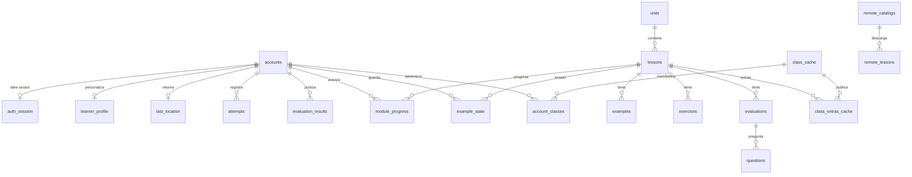

# Esquema de la base de datos (SQLite)

Modelo local de MLO, extraído de [`src/shared/services/db/schema.ts`](../../src/shared/services/db/schema.ts).
`DATABASE_VERSION = 17`. SQLite es la fuente de verdad; los datos remotos se cachean y se
aplican en segundo plano.

## Diagrama ER

## Identidad y sesión

| Tabla | Columnas | Notas |
| --- | --- | --- |
| `accounts` | `id` PK autoincremental, `username` UNIQUE, `external_key` UNIQUE, `display_name`, `password_hash`, `salt`, `created_at` | `external_key` es el UUID estable del alumno (respaldos y listas del docente). Hash PBKDF2-HMAC-SHA256. |
| `auth_session` | `id` PK con `CHECK (id = 1)`, `account_id` FK → `accounts` CASCADE | Sesión única: una fila o ninguna. |
| `learner_profile` | `id` PK, `account_id` UNIQUE FK → `accounts` CASCADE, `learning_style`, `dark_mode` (1), `large_text` (0) | Un perfil por cuenta; `learning_style` viene del CHAEA abreviado. |
| `last_location` | `account_id` PK FK → `accounts` CASCADE, `unit_id`, `lesson_id`, `lesson_code`, `section`, `updated_at` | Última posición de lectura, una por cuenta. |

## Contenido de curso

| Tabla | Columnas | Notas |
| --- | --- | --- |
| `units` | `id` PK texto, `number`, `title`, `description`, `difficulty`, `color`, `catalog_id` (`'base'`), `archived_at` | |
| `lessons` | `id` PK texto, `unit_id` FK → `units` CASCADE, `code`, `title`, `eyebrow`, `body`, `code_sample`, `context_title`, `context_body`, `synthesis` (JSON), `content` (JSON), `position`, `catalog_id`, `archived_at` | |
| `examples` | `id` PK texto, `lesson_id` FK → `lessons` CASCADE, `type`, `title`, `prompt`, `config` (JSON), `steps` (JSON), `hints` (JSON), `explanation` | Ejemplo guiado con feedback inmediato. |
| `exercises` | `id` PK texto, `lesson_id` FK → `lessons` CASCADE, `type`, `prompt`, `instructions`, `correct_order` (JSON), `config` (JSON), `explanation` | Práctica; se evalúa por reactivo. |
| `evaluations` | `id` PK texto, `lesson_id` FK → `lessons` CASCADE, `title`, `description`, `question_count` (10), `exercise_count` (5), `archived_at` | Puntaje acumulado. |
| `questions` | `id` PK texto, `evaluation_id` FK → `evaluations` CASCADE, `order_index`, `type` (`'mcq'`), `config` (JSON), `prompt`, `options` (JSON), `answer`, `explanation` | `answer` es el índice de la opción correcta. |

`Exercise` y `Evaluation`/`Question` se mantienen en tablas separadas a propósito: la primera
da retroalimentación por reactivo y la segunda acumula puntaje. `units`, `lessons` y
`evaluations` se archivan con `archived_at`; no se borran si tienen progreso asociado.

## Clases

| Tabla | Columnas | Notas |
| --- | --- | --- |
| `class_cache` | `class_id` PK texto, `class_code` UNIQUE, `class_name`, `teacher_name`, `version`, `hash`, `published_at`, `fetched_at` | Caché global del release publicado por clase. |
| `class_extras_cache` | PK (`class_id`, `extra_id`), `lesson_id` FK → `lessons` CASCADE, `type`, `payload` (JSON), `position` | Bloques/ejemplos/ejercicios extra. El mismo `extra_id` se deduplica entre clases. |
| `account_classes` | PK (`account_id`, `class_id`), `class_code`, `joined_at`; FK → `accounts` y `class_cache` (CASCADE) | Membresías. Índice único (`account_id`, `class_code`). |

Las clases no cambian de catálogo: agregan contenido extra sobre `base`.

## Progreso y analítica

| Tabla | Columnas | Notas |
| --- | --- | --- |
| `attempts` | `id` PK autoincremental, `account_id` FK CASCADE, `source` (`practice` \| `evaluation`), `item_id`, `item_type`, `lesson_id`, `correct`, `score_correct`, `score_total`, `created_at` | Bitácora real de intentos; sustituye a la antigua `results`. |
| `evaluation_results` | `id` PK autoincremental, `account_id` FK CASCADE, `evaluation_id` FK → `evaluations` CASCADE, `score`, `correct_count`, `total_count`, `created_at` | Resultado agregado por evaluación. |
| `module_progress` | PK (`account_id`, `lesson_id`), `completed`, `updated_at`; FK → `accounts` y `lessons` (CASCADE) | |
| `example_state` | PK (`account_id`, `lesson_id`), `payload` (JSON), `updated_at`; FK → `accounts` y `lessons` (CASCADE) | Estado del ejemplo interactivo. |

## Sincronización remota

| Tabla | Columnas | Notas |
| --- | --- | --- |
| `remote_catalogs` | `catalog_id` PK, `title`, `version`, `manifest_hash`, `lesson_ids` (JSON), `fetched_at` | Manifest descargado por catálogo. |
| `remote_lessons` | PK (`catalog_id`, `lesson_id`), `hash`, `payload` (JSON), `fetched_at`, `applied_hash` | Área de espera; `applied_hash` distingue lo ya aplicado. |
| `meta` | `key` PK, `value` | Clave/valor interno. |

Los ids de contenido remoto son globales (`{catalogId}-{id}`).

## Índices

`idx_class_cache_code`, `idx_class_extras_lesson`, `idx_class_extras_class`,
`idx_account_classes_code`, `idx_lessons_unit`, `idx_examples_lesson`,
`idx_exercises_lesson`, `idx_evaluations_lesson`, `idx_questions_evaluation`,
`idx_progress_account`, `idx_eval_results_account`, `idx_attempts_account_lesson`,
`idx_attempts_account_type`, `idx_units_catalog`, `idx_lessons_catalog`,
`idx_remote_lessons_catalog`.

## Reglas generales

- `PRAGMA foreign_keys` se activa por conexión en `migrateAndSeed`
  (`src/shared/services/db/database.ts`); toda conexión nueva debe reactivarlo.
- Borrar una cuenta arrastra en cascada sus datos personales; el contenido de curso y la
  caché de clases persisten.
- Columnas JSON (`synthesis`, `content`, `config`, `steps`, `hints`, `correct_order`,
  `options`, `payload`, `lesson_ids`) guardan texto serializado; la validación vive en
  `shared/utils/validate.ts`.
