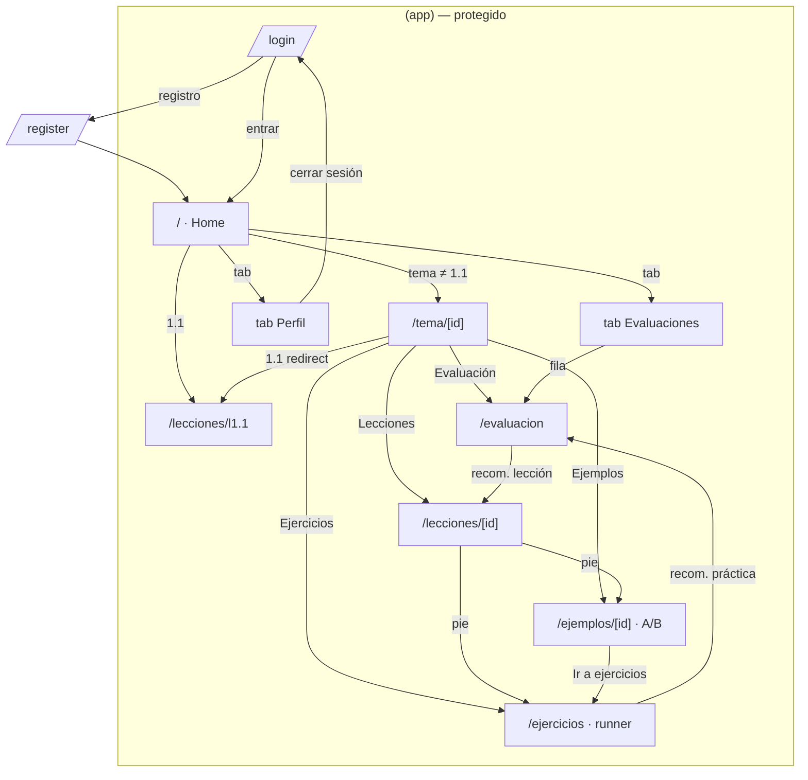

# Mapa de navegación — MLO Ingeniería de Software

> Estado actual (`src/app`). Offline-first; sesión local en SQLite (`auth_session`).
> Guarda global: sin cuenta solo existen `/login` y `/register`; con cuenta, el grupo `(app)`.

## 1. Árbol de rutas

```text
_root (Stack + Stack.Protected)
├── /login                  # acceso sin sesión
├── /register               # alta local (nombre, usuario, contraseña)
└── (app)/                  # grupo protegido (requiere account)
    ├── /                   # Home · tabs Módulos / Evaluaciones / Perfil
    │   ├── tab Módulos
    │   │   ├── [avatar]            → tab Perfil
    │   │   ├── [hero Continuar]    → lección 1.1: /lecciones/[id] · resto: /tema/[id]
    │   │   ├── [UnitCard]          → expande/colapsa en línea (acordeón, 1 abierto)
    │   │   └── [SubtopicRow]       → 1.1: /lecciones/[id] · resto: /tema/[id]
    │   ├── tab Evaluaciones
    │   │   └── [fila evaluación]   → /evaluacion?lesson=<id>
    │   └── tab Perfil
    │       ├── [Cerrar sesión]       → /login
    │       └── [Reiniciar mi progreso] → Alert confirm
    ├── /tema/[id]          # Hub del tema (chip de estado)
    │   ├── lección 1.1     → redirect → /lecciones/l1.1 (sin mosaicos)
    │   └── resto (1.2–1.4) → mosaicos: Lecciones · Ejemplos · Ejercicios · Evaluación
    │       ├── [Lecciones]  → /lecciones/[id]
    │       ├── [Ejemplos]   → /ejemplos?lesson=<id>   (lista: un par A/B por ejercicio del banco)
    │       ├── [Ejercicios] → /ejercicios?lesson=<id> (runner de ejercicios)
    │       └── [Evaluación] → /evaluacion?lesson=<id>
    ├── /lecciones/[id]     # Lectura justificada: tabs Concepto | Síntesis
    │   └── [pie] Ver ejemplo → /ejemplos/[id] (primer ejemplo del tema)
    │       | Practicar       → /ejercicios?lesson=<id>
    │       | Evaluación      → /evaluacion?lesson=<id>
    │       | Terminar        → back (1.1: solo lección)
    ├── /ejemplos           # Lista de ejemplos = todo el banco de ejercicios (un par A/B por ejercicio)
    │   └── [Ejemplo N]     → /ejemplos/[id] (id = ejercicio)
    ├── /ejemplos/[id]      # Ejemplo guiado del mismo tipo que el ejercicio
    │   ├── A (demostración): solución completa paso a paso con el “por qué” → [Ahora inténtalo tú]
    │   └── B (acompañamiento): el usuario lo intenta con pistas (sin dar la respuesta)
    │       └── [Ver solución completa y el porqué] → [Ir a ejercicios] → /ejercicios?lesson=<id>
    ├── /ejercicios         # Runner de ejercicios (arranca aleatorio, sin lista previa ni repetición)
    │   ├── un ejercicio por pantalla (orden aleatorio): "Comprobar" una sola vez
    │   │   correcto o incorrecto → solución + porqué → [Siguiente] (sin reintento ni pistas)
    │   └── resumen: score por tipo + recomendación (repasar lección / más ejercicios) → evaluación
    └── /evaluacion         # Evaluación interactiva (≥15 reactivos, mezcla de tipos)
        ├── mcq → QuizOption; otros → ActivityView
        └── resultado: score global, por tipo y recomendación → lección o práctica
```

## 2. Diagrama



## 3. Profundidad de toques (desde Home)

| Destino | Toques |
|---|---|
| Tab Evaluaciones / Perfil | 1 |
| Lectura de 1.1 (unidad → lección) | 2 |
| Evaluación de un tema (vía tab) | 2 |
| Lección / ejemplo / práctica / evaluación de un tema ≠ 1.1 | 3 (unidad → lección → mosaico) |

## 4. Reglas vigentes

- Sin sesión, cualquier ruta de `(app)` redirige a `/login` (`Stack.Protected`).
- La lección **1.1 es solo lectura**: sin ejemplo, práctica ni evaluación.
- Tipos de actividad: `order`, `fill`, `match` y `crossword` (rejilla predefinida);
  la evaluación añade `mcq`.
- Cada tema tiene **≥6 ejercicios distintos** (sin repetir) en orden mezclado.
- Ejercicios: orden aleatorio sin repetición; **sin pistas**; al comprobar (una sola vez) se
  muestra el resultado con solución y porqué y se pasa a Siguiente (sin reintento).
  Al terminar los ejemplos se entra directo a los ejercicios.
- `attempts` guarda un registro por reactivo (source `practice` | `evaluation`); la analítica
  (`analyticsLogic`) resume aciertos/errores por tipo y recomienda repasar lección o práctica.
- Lectura por bloques ricos (`lessons.content`: párrafos, listas, tablas) con texto justificado.
- Esquema **v5**: `attempts`, `examples` A/B, `questions.type/config`, `exercises.explanation`.
- Progreso, resultados e intentos se escriben con el `account_id` activo.
